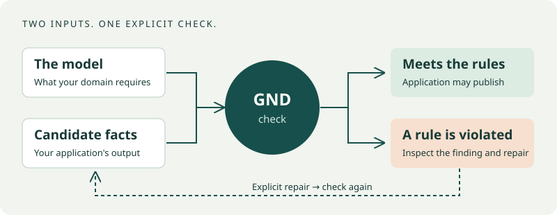

# GND · Get Nick Done

**Build applications with rules you can check.**

GND turns domain requirements into explicit conceptual models and checks the
facts your application produces. Use it with a coding agent, from the command
line, or through Python to catch rule violations, inspect warnings and evolve
an application as its requirements change.

A recommender should never suggest an already-read book. An expense should not
be approved without a recorded submission. A shipment should meet its deadline. GND makes
these conditions inspectable and executable.



## Start with something that runs

- **[First check and repair](docs/quickstart.md):** find a shipping deadline
  violation, inspect the changed facts and verify the repair.
- **[Build BookRec](docs/bookrec/01-model.md):** build a recommendation library
  and CLI with hard rules, advisory warnings and checked output publication.
- **[Build expense approvals](docs/expense/01-model.md):** implement a small
  workflow, reject an invalid state and add currencies through model evolution.

[Install GND](docs/installation.md), then follow a tutorial. After the tutorial
copies its supplied inputs, a Python integration can check both candidates:

<!-- gnd-run expect=0 -->
```python
from gnd import api

bad = api.check("dispatch-demo/model.orm.json", "dispatch-demo/seed.pop.json", admission=True)
good = api.check("dispatch-demo/model.orm.json", "dispatch-demo/repaired.pop.json", admission=True)
print(bad["exit_code"], good["exit_code"])  # 1 0: deadline failure, then passing repair
assert bad["exit_code"] == 1 and good["exit_code"] == 0
```

## What you can do

Model entities, relationships and constraints; check supplied facts and state
transitions; use derived relationships, deadlines and fixed reference data;
generate synthetic populations and Python project scaffolds; evolve or recover
models; run bounded development sessions; extract/render documents; and export
bounded witnesses or native representations where supported.

The [capability guide](docs/reference/capabilities.md) explains prerequisites and
limits. The [documentation home](docs/index.md) connects the complete learning
path, [CLI index](docs/reference/cli.md), [Python API](docs/reference/python-api.md)
and [coding-agent workflows](docs/guides/agent-skills.md).

GND supplies the modeling, checking and workflow machinery. You or your coding
agent write the application logic and review its domain rules. A passing check
concerns those rules and supplied facts; it does not establish real-world truth
or recommendation quality. Base checks and the application tutorials run locally
without model-provider keys. Optional workflows document their extra tools.

## Contribute

See [CONTRIBUTING](CONTRIBUTING.md) and [preview the documentation site](docs/development/documentation.md).
The distribution is `get-nick-done`; import and command names are `gnd`.
Owned code is Apache-2.0; third-party attribution is in [NOTICE](NOTICE).
[Support](docs/support.md) · [Compatibility](docs/compatibility.md) · [Release notes](docs/release-notes.md).

The bundled [zero-install model validator](src/gnd/skills/gnd-model-from-text/scripts/validate_model.py)
is a limited fallback: it does not implement layer-2 semantic model rules or
population checking, cannot return exit band 4 (indeterminate), and does not
provide `--format json` or `acceptance_ready`. Use installed GND for those features.
