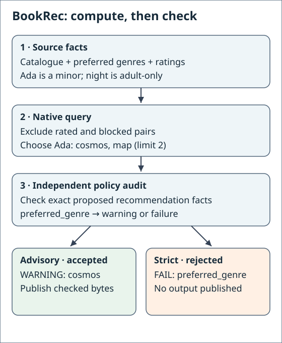
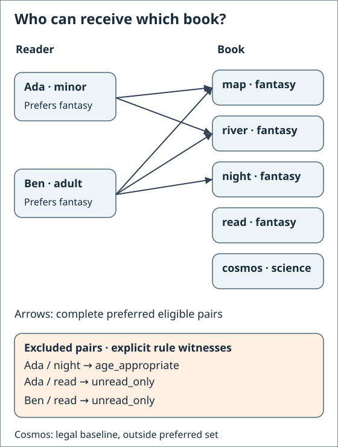
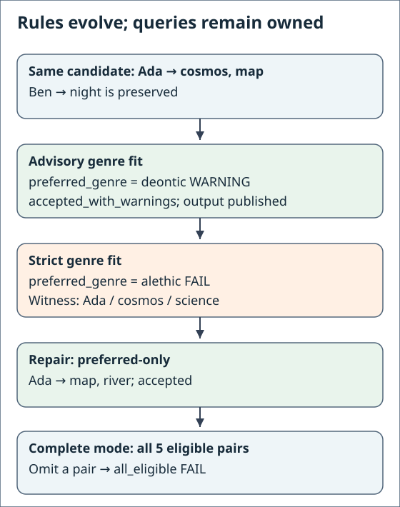

# 7. Run BookRec on PyRel and catch a faulty agent

In this chapter BookRec computes recommendations with a PyRel query, and GND
checks every proposal before anything is saved. You will watch a faulty agent
recommend an adult-only book to Ada, who is a minor, and see the check stop it.
You need the two environments from [PyRel + GND](../pyrel-apps.md#set-up).

## 1. What you'll build

<div class="app-figure" markdown="1" role="region" tabindex="0" aria-label="BookRec calculation and checking flow">

</div>

*Source: shipped baseline/strict models and measured advisory/strict checkpoints.
The same Ada/cosmos candidate warns under `preferred_genre` in advisory mode and
fails under the strict model.*

On narrow screens, focus a diagram and scroll horizontally with arrow keys or touch.

| Step | Who does it | Where it lives |
|---|---|---|
| Propose recommendations | The candidate producer: here a PyRel query, in your app possibly an LLM agent | `native_query.py` |
| Compute who can read what | PyRel | `native_query.py` |
| Sort and keep the first few | Plain Python | `native_query.py` |
| Check the rules, then save | GND, using PyRel to run the check | the model files |

The rules live in the model, not in the query. The applications here run on
PyRel 1.30.1 with DuckDB 1.5.5, locally, with no account. A passing check means
the supplied facts satisfy the modeled rules; it says nothing about whether
they describe the world.

## 2. Get a fresh copy and check both environments

Work in the folder where you created the two environments. Run Python blocks
with the GND interpreter: save one as a file, for example `step.py`, and run
`"$GND_TUTORIAL_GND_PYTHON" step.py`. Start from the shipped example,
so earlier chapters cannot change the starting facts:

<!-- gnd-run expect=0 output=stdout -->
```python
from importlib.resources import files
import shutil

shutil.copytree(str(files("gnd").joinpath("examples", "bookrec")), "bookrec-native")
print("Copied the BookRec example to bookrec-native/")
```

```text
Copied the BookRec example to bookrec-native/
```

<!-- gnd-run expect=0 output=stdout -->
```sh
"$GND_TUTORIAL_GND_PYTHON" -c "import gnd; print('GND is ready')"
```

```text
GND is ready
```

<!-- gnd-run expect=0 lane=pyrel output=stdout -->
```sh
"$GND_TUTORIAL_PYREL_PYTHON" -c "from importlib.metadata import version as v; print('PyRel', v('relationalai'), 'with DuckDB', v('duckdb'))"
```

```text
PyRel 1.30.1 with DuckDB 1.5.5
```

## 3. One rule, and the query that respects it

The model's `age_appropriate` rule says: a minor is never recommended an
adult-rated book. Here is how the PyRel query avoids those pairs while it computes:

```python
# A minor reader and an adult-rated book: never recommend this pair.
blocked = m.where(reader, book, app.match('user_is_minor', user=u), app.match('book_rated_adult', book=b))
blocked_pair = app.relationship('blocked', user=String, book=String)
blocked.define(blocked_pair(u, b))
...
clauses = [reader, book,
           m.not_(app.match('user_rated_book', user=u, book=b)),   # not read yet
           m.not_(blocked_pair(u, b))]                             # not blocked
```

`m` is an ordinary PyRel model, `String.ref()` makes query variables, and
`m.not_(...)` excludes matches. `app` is the small
[query toolkit](../pyrel-apps.md#the-query-toolkit) GND hands your query:
`app.match` matches a fact list, and `app.relationship` declares a helper relation
that `.define` fills. `reader` and `book` are matches set up a few lines earlier
in the full source below. Avoiding a bad pair here is helpful, but it is not a
guarantee: GND still checks the result against the rule itself.

<div class="app-figure" markdown="1" role="region" tabindex="0" aria-label="BookRec reader, book and genre eligibility">

</div>

*Source: complete-mode checkpoint's five eligible pairs and blocked/read pairs.
The exclusion labels name the rules checked when a bad proposer inserts those pairs.*

## 4. Run the app

<!-- gnd-run expect=0 lane=pyrel output=stdout -->
```sh
(cd bookrec-native/extension && "$GND_TUTORIAL_GND_PYTHON" -m bookrec.cli recommend --user ada \
  --model ../model.orm.yaml --input ../seed.population.json --output ../ada.json \
  --backend pyrel --pyrel-python "$GND_TUTORIAL_PYREL_PYTHON" --format text)
```

```text
Proposed for ada: cosmos, map
Policy check: ACCEPTED with 1 warning
  warning     preferred_genre {"$b": "cosmos", "$g": "science", "$u": "ada"}
Published: ../ada.json
```

Ada gets two books. The saved file is `bookrec-native/ada.json`; paths in the
output are relative to `bookrec-native/extension`. `preferred_genre` is a should-rule in this model, so a
science book outside her preferred genres is a warning, not a failure, and the
recommendations are saved. Each line under the verdict is a witness (the exact
facts that break the rule), here Ada, cosmos and its genre. `$u`, `$b` and `$g`
are the rule's own variable names, for the user, the book and the genre.

## 5. A faulty agent

Now play the agent yourself. The shipped file `adult-for-minor.population.json`
proposes `night`, an adult-rated book, for Ada and Ben. You are injecting it on
purpose, as a stand-in for an agent that got it wrong. The `check` command
with `--proposal` checks a supplied candidate instead of computing one:

<!-- gnd-run expect=1 lane=pyrel output=stdout -->
```sh
(cd bookrec-native/extension && "$GND_TUTORIAL_GND_PYTHON" -m bookrec.cli check \
  --model ../model.orm.yaml --input ../seed.population.json \
  --proposal ../adult-for-minor.population.json --output ../agent.json \
  --backend pyrel --pyrel-python "$GND_TUTORIAL_PYREL_PYTHON" --format text)
```

```text
Checking the agent's proposal: ada/night, ben/night
Policy check: REJECTED
  violated    age_appropriate {"$b": "night", "$u": "ada"}
Nothing was published.
```

Ben is an adult, so only Ada's pair breaks the rule. No query ran here, so
nothing could filter the bad pair out first: the check alone caught it. The
same happens when an agent recommends a book Ada has already read:

<!-- gnd-run expect=1 lane=pyrel output=stdout -->
```sh
(cd bookrec-native/extension && "$GND_TUTORIAL_GND_PYTHON" -m bookrec.cli check \
  --model ../model.orm.yaml --input ../seed.population.json \
  --proposal ../tutorial-assets/checkpoints/already-read-refusal.input.json --output ../agent-read.json \
  --backend pyrel --pyrel-python "$GND_TUTORIAL_PYREL_PYTHON" --format text)
```

```text
Checking the agent's proposal: ada/map, ben/night, ada/read
Policy check: REJECTED
  violated    unread_only {"$b": "read", "$u": "ada"}
Nothing was published.
```

## 6. Fix it and rerun

Ben's `night` pick was already in the input, and it is fine because Ben is an
adult. A corrected proposal keeps it and gives Ada `cosmos` and `map` instead,
the same picks the query made in step 4. The check accepts it and saves it:

<!-- gnd-run expect=0 lane=pyrel output=stdout -->
```sh
(cd bookrec-native/extension && "$GND_TUTORIAL_GND_PYTHON" -m bookrec.cli check \
  --model ../model.orm.yaml --input ../seed.population.json \
  --proposal ../tutorial-assets/checkpoints/advisory.candidate.json --output ../fixed.json \
  --backend pyrel --pyrel-python "$GND_TUTORIAL_PYREL_PYTHON" --format text)
```

```text
Checking the agent's proposal: ben/night, ada/cosmos, ada/map
Policy check: ACCEPTED with 1 warning
  warning     preferred_genre {"$b": "cosmos", "$g": "science", "$u": "ada"}
Published: ../fixed.json
```

## 7. Change a rule without touching the query

`strict.orm.yaml` makes `preferred_genre` a must-rule. Same query, same facts:

<!-- gnd-run expect=1 lane=pyrel output=stdout -->
```sh
(cd bookrec-native/extension && "$GND_TUTORIAL_GND_PYTHON" -m bookrec.cli recommend --user ada \
  --model ../strict.orm.yaml --input ../seed.population.json --output ../strict.json \
  --backend pyrel --pyrel-python "$GND_TUTORIAL_PYREL_PYTHON" --format text)
```

```text
Proposed for ada: cosmos, map
Policy check: REJECTED
  violated    preferred_genre {"$b": "cosmos", "$g": "science", "$u": "ada"}
Nothing was published.
```

The query still finished and still proposed cosmos. A query that finishes is
not the same as a passing check. Ask the query for preferred genres only:

<!-- gnd-run expect=0 lane=pyrel output=stdout -->
```sh
(cd bookrec-native/extension && "$GND_TUTORIAL_GND_PYTHON" -m bookrec.cli recommend --user ada --preferred-only \
  --model ../strict.orm.yaml --input ../seed.population.json --output ../preferred.json \
  --backend pyrel --pyrel-python "$GND_TUTORIAL_PYREL_PYTHON" --format text)
```

```text
Proposed for ada: map, river
Policy check: ACCEPTED
Published: ../preferred.json
```

<div class="app-figure" markdown="1" role="region" tabindex="0" aria-label="BookRec advisory, strict and complete rules">

</div>

*Source: advisory, strict, preferred and complete native checkpoint reports.*

### Go further: the complete list

`complete.orm.yaml` adds rules that require every eligible pair, not just a few:

<!-- gnd-run expect=0 lane=pyrel output=stdout -->
```sh
(cd bookrec-native/extension && "$GND_TUTORIAL_GND_PYTHON" -m bookrec.cli complete \
  --model ../complete.orm.yaml --input ../seed.population.json --output ../complete.json \
  --backend pyrel --pyrel-python "$GND_TUTORIAL_PYREL_PYTHON" --format text)
```

```text
Proposed: ada/map, ada/river, ben/map, ben/night, ben/river
Policy check: ACCEPTED
Published: ../complete.json
```

## 8. Recap

The producer proposed, PyRel computed, Python sorted, and GND checked before
saving. Bad proposals were refused whether or not a query had filtered them, and
changing a rule needed no query change. A warning still saves, a violation
refuses, and an unknown fact list is never treated as empty. Your input files
were never modified.

## Troubleshooting

The exit code is the number `echo $?` prints right after a command. An input's
coverage list (`covers`) names the fact lists the input vouches for; a list it
does not name is unknown, which is different from a list that is declared but empty.

| What you see | Why | What to do |
|---|---|---|
| `--backend pyrel requires --pyrel-python` | No PyRel interpreter given | Add `--pyrel-python` with your PyRel interpreter |
| `NOT RUN` mentioning the interpreter or `requires PyRel 1.30.1` | Wrong environment | Rebuild it as in [Set up](../pyrel-apps.md#set-up) |
| `NOT RUN (ProfileRefusal: coverage-not-declared)`, exit code 2 | The input has no coverage list | Add the `covers` list for the facts you actually have |
| `NOT ACCEPTED (some rules could not be decided)`, exit code 2 | A rule needs a fact list the input does not cover | Cover that list, or leave it out on purpose and accept the refusal |
| `NOT RUN (...)`, exit code 3 | The input or proposal is malformed, or changed facts it does not own | Fix the file; a proposal may only change `recommendation` |
| `NOT RUN (output already exists)` | Outputs are never overwritten | Choose a new `--output` path |
| `FileExistsError` at the copy step | You ran the chapter before in this folder | Start again in a new empty folder |

## Next steps

- Write rules for your own domain with
  [gnd-model-from-text](../agents/model-from-text.md), then build the same kind of app.
- Drive a real LLM agent against the same model and checker. That is a separate
  session contract you write for [`gnd exp run`](../agents/dev-session.md); it
  does not run this CLI.
- Running against Snowflake is outside this tutorial and outside the
  applications runtime, which refuses non-local connections.

The recommender is deliberately tiny: it shows the integration, not ranking quality.

## The whole query

??? note "Read the shipped native query source"

    ```python
    --8<-- "docs/assets/applications/bookrec-native-query.txt"
    ```
