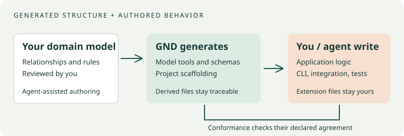

# A model, some facts, and a question

Suppose an application recommends books. You want to ask: **Does this output
include a book the reader already read?** That question needs both a rule and
facts. GND keeps them explicit so you can inspect either one.

## Model the domain before the algorithm

A conceptual model describes the things and relationships your application
cares about. In BookRec those include readers, books, ratings and recommendations.
A fact type such as “a reader rated a book” has two roles: reader and book.
A population supplies concrete rows, such as Ada rated *River Maps*.

| Term | Meaning | BookRec example |
|---|---|---|
| Object type | A kind of thing or value | Reader, Book, Genre |
| Fact type | A relationship with named roles | Reader rated Book |
| Population | The facts being checked | Ada rated River Maps |
| Constraint | A condition the facts must or should satisfy | Rated and recommended pairs must not overlap |
| Derivation | A supported rule defining additional relationships | A book is eligible when preferred, unread and allowed |
| Provenance | Why a rule is present | The requirement sentence that motivated it |

GND uses **Object-Role Modeling (ORM)**. Here ORM means conceptual modeling,
not a database object-relational mapper. You do not need a database to use it:
models and populations can be ordinary YAML and JSON files.

## Hard rules and advice answer different questions

A hard, **alethic** constraint decides whether an output conforms. A violated
hard constraint makes an otherwise well-formed check fail. A **deontic**
constraint records advice or policy warnings: the output can still be accepted
with a warning. This distinction is useful for “never recommend an already-read
book” versus “prefer the reader's favorite genre.”

Choose that interpretation explicitly during modeling. The words “must” and
“should” in a prompt do not remove the need to review the generated model.
[BookRec chapter 2](bookrec/02-facts.md) makes the distinction concrete.

## Model validity and population validity

`gnd validate` checks whether the model itself is well-formed and supported.
`gnd check` asks whether supplied facts satisfy that model. An invalid input or
an unsupported/incomplete case is different from a genuine rule violation.
Read the report and [command-specific exit meanings](reference/formats.md),
rather than treating every nonzero status as a failed business rule.

A checker needs a declared scope. A complete list of submitted expenses and a
partial excerpt from a receipt are different inputs. Admission, source anchors,
reference populations and unresolved facts help represent particular boundaries;
they are not an automatic guarantee that every real-world fact was supplied.

## Where the developer and agent fit

{ .mechanism }

1. Describe the requirements and review an agent-authored model.
2. Validate it and inspect small populations, including intentional mistakes.
3. Generate a Python project and write the application logic in its extension files.
4. Check the produced facts before deciding to publish or act on them.
5. Change the model explicitly when requirements change, then check conformance.

GND supplies the model/checking machinery and structured workflows. A developer
or coding agent supplies domain understanding and application behavior. Generated
scaffolding does not invent a recommender, storage backend or user interface.

## Try changing the question

An output can be legal yet incomplete. “Every recommended book is eligible”
does not say “every eligible book is recommended.” BookRec's final chapter
adds a derivation and completeness rule to illustrate the difference.
Likewise, a valid expense state does not by itself prove the operation that
produced it was authorized; [transition auditing](guides/data-and-transitions.md)
is a separate question.
