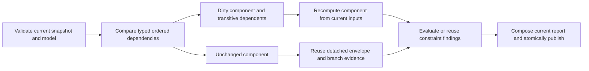

# Derive facts and check changes

Snapshot checking answers “Are these facts consistent with the rules?”
Derivations answer “What follows from these facts?” Transition checking answers
“Do these declared operations explain this state change?” Choose the question
before choosing the command.

## Derive relationships instead of asking an agent to guess them

Suppose a shipping catalog says that warehouse A connects to B and B connects
to C. A structured derivation can compute that A reaches C. Similarly, BookRec
can derive eligible reader/book pairs from catalog and reading-history facts.
An application can then compare its proposed output with that derived set.

A structured rule binds variables in positive body atoms, optionally filters
or negates supported atoms, and projects its head. Multiple clauses describe
alternative ways to derive the same relation. Positive recursive rules can
compute a transitive closure. Negation must be stratified: a relation cannot
depend negatively on itself through a cycle.

Derived and semiderived claims differ. A `derived` relation's supplied claims
must match its computed extension; a `semiderived` relation permits additional
claims under its defined comparison semantics. Opaque derivation prose has no
executable rule. Choose these intentionally rather than treating every field
marked “derived” as mechanically computable.

Exact aggregates support `count`, `sum`, `min`, `max`, and `avg` over supported
integer inputs. Contributions are identified by the ordered `over` variables
and evaluated value, so duplicate proof paths do not inflate a sum. An empty
body produces no group: GND does not invent a zero-count row. An average stays
an exact rational; use supported explicit rounding before placing it in a
head. The [rule grammar](https://github.com/vasiloglou/gnd-public/blob/main/src/gnd/skills/gnd-orm-core/references/representation-format.md#orm--derived-fact-types)
defines the supported expressions and resource bounds.

## Separate the candidate from fixed reference data

Use fixed reference populations for a catalog the candidate must not redefine:
approved warehouses, product lists, or dependency edges. A version-4 model
declares each reference's relative path, owned fact types, and exact raw-byte
SHA-256. The candidate and references have disjoint ownership.

Reference facts can help satisfy a rule, but they are not candidate production
credit. Missing, changed, or invalid reference files cause input refusal; they
do not become an empty catalog. Even reformatting a catalog changes its byte
identity. Keep the model and selected reference files together when copying
an example or deploying an integration.

Try the [dispatch quickstart](../quickstart.md), then change the candidate's
requested warehouse to one outside the approved relation. Compare that domain
failure with the input refusal caused by removing the reference file. They
require different application responses.

## Express calendar deadlines with supplied dates

The dispatch example checks `start + shipping window <= due date`. `Date`
uses a calendar day, and `Duration` represents a nonnegative day count.
`date_add` and `date_sub` provide calendar-day arithmetic; this is not a
wall-clock scheduler, timezone conversion library, or business-day calendar.
Supply the dates that your application intends to check.

Temporal checking is supported in validation, snapshot checking and the
documented transition/report surfaces. Support does not extend to every
consumer: temporal models are currently refused by `codegen`, conformance,
`extract`, `doccheck`, `synth`, `measure`, and `diff`. Use the
[capability matrix](../reference/capabilities.md) before combining workflows.

## Audit a transition

A model can declare named operations, parameters, preconditions, effects, and
frame modality. A walk lists the operation invocations that allegedly carried
a pre-population to a post-population. Contextual commands for authored files:

```sh
gnd validate model.orm.yaml --trace
gnd check model.orm.yaml --pre before.pop.json --steps steps.json --post after.pop.json --format json
```

Use the text `--trace` output to obtain `model_digest` and
`operations_digest`; a steps document requires both. Do not substitute the raw
file hash or add `--format json` expecting a JSON trace. Each step must name
a declared operation and bind exactly its parameters.

GND checks the pre-state, operation preconditions, intermediate states, and
the declared post-state. It also compares declared and computed changes for
fact types touched by the walk. An unrelated fact type outside that touched
set is outside the frame check; its constraints may still catch an invalid
change. Missing coverage for a touched relation is an input refusal.

## Check a plan and its side effects

Two modes use the same walk format:

- **Plan mode** omits `--post`. GND computes the post-state, so an agent's proposed
  plan can be checked *before* anything runs. A failed precondition names the step,
  the operation and the binding.
- **Audit mode** supplies the claimed `--post`. GND compares every change in the
  claimed post-state with the changes the declared operations make. A change that
  no operation makes is an undeclared side effect, and the **frame check** fails it.
  That holds even when every fact in the claimed state is individually legal, which
  is exactly the case no snapshot check can see.

[Check an agent's plan](../agents/plans.md) runs both modes on the packaged
`approvals` example: a plan that skips the approval and Workday steps fails
`pre_submitted`, the revised plan passes, and a walk that silently flips a
bystander expense to `rejected` fails the frame check.

The [Python API reference](../reference/python-api.md#transition-audit-an-operation-including-its-side-effects)
contains a complete runnable activation walk. The
[expense tutorial](../expense/01-model.md) teaches application-side changes and
post-operation checks. Do not confuse an application changing a JSON file and
then calling `check` with a GND operation-walk audit; they verify different
things.

The authoritative [walk contract](https://github.com/vasiloglou/gnd-public/blob/main/src/gnd/skills/gnd-orm-core/references/representation-format.md#walks--stepsjson-and-transition-evaluation)
defines digest binding, frame scope, dynamic rules, and evaluation order.

## Check compiled standing obligations in a snapshot

Use `gnd check MODEL POP --compiled-operations --format json`, or add the same
flag to `gnd check MODEL --populations DIR --format json`. In Python use
`api.check(model, population, compiled_operations=True)`. This is an explicit
assertion that eligible operational implications apply to the population.
Ordinary snapshots keep their current behavior. The generated failure reference
names its operation/precondition source, so single and batch callers can compare
identical obligation sets. The option cannot combine with occurrence admission.
See the [canonical compiled-obligation contract](https://github.com/vasiloglou/gnd-public/blob/main/src/gnd/skills/gnd-orm-core/references/representation-format.md#compiled-obligations)
for coverage, uncertainty, work limits and the walk-only boundary.


## Recheck related populations in one process

Create an explicit `api.EvaluationSession` when a host repeatedly checks related
validated snapshots. Current content and model bindings determine eligibility.
A change propagates through positive, negative and aggregate dependencies to whole
recursive components. Unchanged components reuse their private complete envelope;
dirty components calculate from current inputs. Constraint reuse keeps current
witness coordinates and final report composition. Unsupported modes run fresh.



Full admission, operation obligations, intermediate snapshots, declared/computed
post-state checks and refusal precedence remain in place. Existing explicit
pre-receipts retain their narrower pre-check skip. Session results are not portable
assurance evidence. See the [Python contract](../reference/python-api.md#reusing-evaluation-work-across-snapshots)
for lifetime, caps and fallback counters, and the [host loop](../agents/dev-session.md#a-host-loop-in-one-python-process)
for observations validated before the next attempt. No row-delta recursion or
constant-time snapshot comparison is promised.
