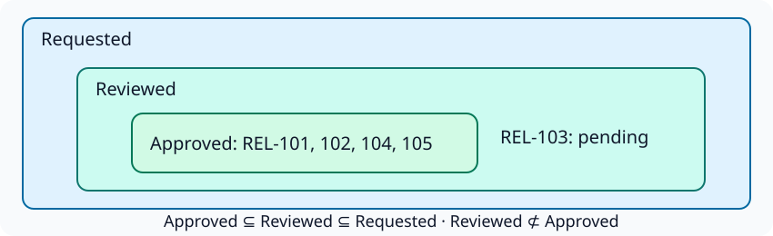

# Lean: prove a finite policy and find a counterexample

Use this when checking one successful snapshot is insufficient: you want to know
whether one policy follows from the others. Continue from [the shared setup](scenario.md).
You will inspect generated propositions, complete three proofs, and refute an
incorrect implication. The application is a small approval-policy library.

## Select a finite policy view

Our proof view states **approved ⊆ reviewed**, **reviewed ⊆ requested**, and
**approved ⊆ requested**. The third rule should follow from the first two.
A pending release may be reviewed without being approved. This view deliberately
omits the audit model's mandatory approval rule and reviewer identity policies.

The diagram shows the pending counterexample used later in the guide.



The selected GND exporter accepts finite value carriers and positive acyclic
rules. It cannot export the recursive dependency graph from the previous guide.
That is a supported-profile boundary, not evidence that the graph is false.

<!-- gnd-run expect=2 -->
```sh
gnd export lean release-governance/dependencies/model.orm.json release-governance/dependencies/repaired.base.pop.json --toolchain leanprover/lean4:v4.34.0 --raw --out unsupported-recursive-lean --json
```

<!-- gnd-run expect=0 -->
```sh
gnd export lean release-governance/approval-proof/model.orm.json release-governance/approval-proof/repaired.pop.json --toolchain leanprover/lean4:v4.34.0 --raw --out lean-approval --json
gnd export lean-verify lean-approval --json
```

<!-- gnd-run expect=0 -->
```python
import json
from pathlib import Path
assert not Path("unsupported-recursive-lean").exists()
source = json.loads(Path("lean-approval/source-map.json").read_text())
obligations = json.loads(Path("lean-approval/obligations.json").read_text())
assert source["carriers"][0]["values"][2] == {"ordinal": 2, "value": "REL-103"}
assert source["relations"] == [{"address": "/fact_types/0", "symbol": "r0"}, {"address": "/fact_types/1", "symbol": "r1"}, {"address": "/fact_types/2", "symbol": "r2"}]
assert obligations["constraints"][2]["id"] == "approved_requested"
assert obligations["constraints"][2]["proposition"] == "redundant2"
assert all(c["status"] == "unproved" for c in obligations["constraints"])
print("Source map: r0 requested, r1 reviewed, r2 approved; ordinal 2 is REL-103.")
```

`Definitions.lean` defines `Population`, finite carrier `Fin 5`, relation lists,
constraint outcomes, and propositions. `ProofObligations.lean` contains explicit
`by sorry` templates. The export has not proved those propositions.

| Proposition | What it asks |
|---|---|
| `concreteWitness` | Is this supplied population well typed, nonempty, and hard-policy compliant? |
| `satisfiability` | Does some population over these finite carriers satisfy those conditions? |
| `redundant2` | For every well-typed population, do the other hard constraints imply approved ⊆ requested? |

The lists can vary; the proof of redundancy quantifies over their interpretations,
not just our one concrete snapshot. Carriers remain fixed to these five IDs.
Concrete validity alone would not answer the universal redundancy question.

## Compile definitions and recognize unproved templates

These commands require the provisioned **Lean 4.34.0** toolchain:

<!-- gnd-run expect=0 lane=lean -->
```sh
gnd export lean-compile lean-approval --executable "${GND_TUTORIAL_LAKE:-lake}" --elaborate-stubs --json > lean-compile.json
```

<!-- gnd-run expect=0 lane=lean -->
```python
import json
from pathlib import Path
result = json.loads(Path("lean-compile.json").read_text())
assert result["exit_code"] == 0 and result["status"] == "compiled"
assert result["proof_status"] == "unproved"
assert result["definitions"]["status"] == result["stubs"]["status"] == "completed"
print("Definitions and templates elaborate; proof status remains unproved.")
```

Lean accepts `sorry` as a placeholder. A zero compiler exit from a template is
therefore insufficient. We now create **separate developer-owned proof sources**
that import only verified definitions, leaving the bundle unchanged.

<!-- gnd-run expect=0 -->
```python
from pathlib import Path
import shutil
proofs = Path("approval-proofs")
proofs.mkdir()
for name in ("Definitions.lean", "lean-toolchain"):
    shutil.copy2(Path("lean-approval") / name, proofs / name)
for name in ("Proofs.lean", "FalseClaim.lean"):
    shutil.copy2(Path("release-governance") / name, proofs / name)
print("Copied verified definitions and developer-owned proofs; templates are not imported.")
```

## Complete proofs using ordinary tactics

```lean
--8<-- "src/gnd/examples/release_governance/Proofs.lean"
```

`candidate_valid` uses `decide` to reduce the concrete finite calculation in the
kernel. `policy_satisfiable` supplies that concrete population as an existential
witness. `approval_requested_redundant` uses subset transitivity: an approved
release is reviewed, and every reviewed release is requested.

The helper `holds_subset` connects GND's generated Outcome predicate to list
membership. It is not a replacement generated model. The theorem uses the actual
`redundant2` proposition, so a change to the definitions can break the proof.

<!-- gnd-run expect=0 lane=lean -->
```sh
(cd approval-proofs && export LEAN_PATH="$PWD" && "${GND_TUTORIAL_LAKE:-lake}" env lean -o Definitions.olean Definitions.lean && "${GND_TUTORIAL_LAKE:-lake}" env lean Proofs.lean > proof-audit.txt)
```

## Refute the tempting converse

REL-103 is requested and reviewed but pending. Its approval is removed in the
proof's `pending` interpretation. This interpretation satisfies all three subset
policies; it disproves “every reviewed release is approved.”

The following deliberately false proof must fail:

```lean
--8<-- "src/gnd/examples/release_governance/FalseClaim.lean"
```

<!-- gnd-run expect=1 lane=lean -->
```sh
(cd approval-proofs && export LEAN_PATH="$PWD" && "${GND_TUTORIAL_LAKE:-lake}" env lean FalseClaim.lean > false-claim.txt 2>&1)
```

<!-- gnd-run expect=0 lane=lean -->
```python
from pathlib import Path
text = Path("approval-proofs/false-claim.txt").read_text()
assert "decide" in text and "false" in text.lower()
audit = Path("approval-proofs/proof-audit.txt").read_text()
for theorem in ("candidate_valid", "policy_satisfiable", "approval_requested_redundant", "reviewed_does_not_imply_approved"):
    assert "ReleaseProof." + theorem in audit
assert all(forbidden not in audit for forbidden in ("sorryAx", "Lean.ofReduceBool", "Lean.ofReduceNat"))
print(text.strip())
print(audit.strip())
```

`reviewed_does_not_imply_approved` completes the repair by proving the negation
using that counterexample. The `#print axioms` output audits theorem dependencies,
including dependencies inherited through helpers. Completed sources use no added
axioms, `sorry`, or `native_decide`. Ordinary foundational axioms, if reported,
remain visible; this is not a claim to eliminate Lean's trusted foundation.

<!-- gnd-run expect=0 lane=lean -->
```sh
gnd export lean-verify lean-approval --json
```

The original bundle still verifies and its obligation metadata remains unproved.
The completed tutorial theorems are separate evidence, not a new GND proof replay
command or assurance upgrade. A real release policy may require richer domains
than this finite exporter profile supports.

## Exercise and explicit handoff

Exercise: remove the reviewed ⊆ requested assumption from the redundancy theorem.
Construct an approved and reviewed release absent from requested, then observe why
the implication no longer holds. Keep the generated definitions unchanged and
write the experiment in a new developer-owned proof file.

> Use `gnd-export` for the supplied finite policy view and verify its bundle.
> I explicitly select Lean compilation. Then hand off proof authoring: import
> verified definitions into a separate workspace, complete the selected theorems,
> test the false claim, and audit dependencies. Do not mark generated templates
> proved or claim unrestricted ORM entailment.

Read the official [proof validation guide](https://lean-lang.org/doc/reference/latest/ValidatingProofs/)
and [Theorem Proving in Lean](https://lean-lang.org/theorem_proving_in_lean4/).
Continue to [interpret the combined release evidence](decision.md).
