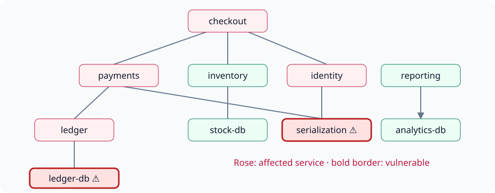

# Release governance across three runtimes

A release manager needs three different answers: **Are the approval facts valid?**
**Which services depend on vulnerable components?** **Does an approval policy
follow from the other rules?** Checking a snapshot, computing a graph, and proving
a statement answer different questions. This learning path makes each useful.

You will audit five releases, repair their approvals, trace vulnerabilities through
a service graph, and complete finite Lean proofs. All names and vulnerabilities
are synthetic. The snapshots do not represent a real vulnerability feed, deployment
system, event history, or production release authorization.

## The situation

| Release | Service / requester | Initial approval | Problem |
|---|---|---|---|
| REL-101 | checkout / Alice | Alice | Self-approval; Alice is also outside the reviewer allowlist |
| REL-102 | inventory / Ben | Maya | Valid approval |
| REL-103 | reporting / Cara | absent | Missing approval |
| REL-104 | payments / Dana | Maya and Noah | Conflicting approvals under the one-reviewer policy |
| REL-105 | ledger / Evan | Zoe | Unauthorized reviewer |

The repaired snapshot uses Noah, Maya, Maya, Maya, Noah respectively. Approval
repair does **not** remove vulnerabilities. A separate patched snapshot clears
both synthetic vulnerability facts, representing an explicitly revised catalogue.



Edges point from a component to its dependency. Serialization affects checkout,
payments and identity; ledger-db affects checkout, payments and ledger. Inventory
and reporting are disconnected from those vulnerable components. There are ten
components, six deployable services and nine base edges.

## Install and provision deliberately

First [install GND](../installation.md) in its own environment. The offline parts
of these guides need only GND and Python. For PyRel, clone the documentation
checkout and run the following **setup commands**, outside the tutorial runner:

```sh
uv sync --project tutorials/runtimes --locked --only-group tutorial-runtimes --python 3.13
export GND_TUTORIAL_PYREL_PYTHON="$(pwd)/tutorials/runtimes/.venv/bin/python"
```

After copying the resources below, installed-wheel readers can instead use `uv sync --project release-governance/runtime-environment --locked --only-group tutorial-runtimes --python 3.13` and set `GND_TUTORIAL_PYREL_PYTHON` to that environment’s absolute `bin/python` path. The packaged project and lock are exact copies of the maintained tutorial project.

This separate project locks `relationalai==1.30.1`, `duckdb==1.5.5`, and their
transitive dependencies. PyRel requires Pydantic below 2.13; GND requires 2.13.4.
Installing them together is not a supported setup. GND commands retain their GND
interpreter; native PyRel commands name the separate interpreter explicitly.
The tutorial runner also selects that interpreter for Python blocks marked
`lane=pyrel`; run their code with the same interpreter when following manually. Python 3.11–3.13
is supported by this tutorial runtime. No Snowflake account or API key is needed.

Install **Soufflé 2.5, 64-bit POSIX**, following the
[official installation instructions](https://souffle-lang.github.io/install).
Select its executable with `GND_TUTORIAL_SOUFFLE=/absolute/path/to/souffle` if it
is not on PATH. Confirm `souffle --version` reports 2.5 and 64 bits.

Provision **Lean 4.34.0** from the
[official release](https://github.com/leanprover/lean4/releases/tag/v4.34.0),
or install that exact toolchain with `elan toolchain install leanprover/lean4:v4.34.0`. Set
`GND_TUTORIAL_LAKE=/absolute/path/to/lean-4.34.0/bin/lake` when using an unpacked
release. `lake --version` must identify Lean 4.34.0. GND compilation invokes the
cached toolchain; it does not install one for you. Proofs use Lean's standard
library, with no Mathlib download.

## Start in an empty working directory

The next command copies **installed package resources**. It works without the
old source repository. Use it once per working directory; occupied destinations
are refused so an exercise cannot silently replace your work.

<!-- gnd-run expect=0 -->
```python
from importlib.resources import files
from pathlib import Path
import shutil

source = files("gnd").joinpath("examples/release_governance")
shutil.copytree(Path(str(source)), "release-governance")
print("Copied the complete synthetic scenario, models, programs and checkpoints.")
```

<!-- gnd-run expect=0 -->
```python
import json
from pathlib import Path
from gnd.api import validate, check

root = Path("release-governance")
scenario = json.loads((root / "scenario-invalid.json").read_text())
assert len(scenario["services"]) == 6 and len(scenario["dependencies"]) == 9
assert len({x for edge in scenario["dependencies"] for x in edge}) == 10
for profile in ("policy", "dependencies", "approval-proof"):
    assert validate(root / profile / "model.orm.json")["exit_code"] == 0
assert check(root / "policy/model.orm.json", root / "policy/invalid.pop.json")["exit_code"] == 1
assert check(root / "policy/model.orm.json", root / "policy/repaired.pop.json")["exit_code"] == 0
print("All three model views validate; flawed approvals fail and repaired approvals pass.")
```

## Three model views, three meanings

| View | Source facts and rules | What it omits |
|---|---|---|
| `policy/` | Requests, approvals, reviewer allowlist; mandatory release coverage, one approval per release, allowlisted reviewer | Self-approval joins are taught in the native program; no dependency or temporal rules |
| `dependencies/` | Dependency edges, deployable services, vulnerabilities, requested services; recursive reachability, exposure, negation, counts and blocked releases | All approval constraints; Soufflé export excludes constraint evaluation and operations |
| `approval-proof/` | Unary requested, reviewed, approved release sets; approved ⊆ reviewed ⊆ requested and the redundant approved ⊆ requested rule | Reviewer identities and mandatory approval; pending reviewed releases are permitted |

Requests map to `request` rows in the first two views and `requested` in the
proof view. Approval release IDs map to `approved` in the proof view; the repaired
scenario has all five. The supplied reviewed roster maps to `reviewed`. These
are explicit author-selected views, not automatic model conversion.

For derivation export, `*.base.pop.json` supplies base facts only. The matching
`*.pop.json` additionally contains the checked expected derived relations.
GND's exporter refuses asserted derived rows instead of accepting an application's
answer as an input. Full base coverage means absent facts are known absent;
negation and unaffected-service results depend on that choice.

## Follow with or without native tools

Continue to [PyRel](pyrel.md), [Soufflé](souffle.md), or [Lean](lean.md). Each guide
marks its native steps and includes checkpoints for readers without that tool.
To execute the actual documented blocks from a documentation checkout:

```sh
uv run python tools/run_tutorials.py --group runtime-pyrel --lane pyrel
uv run python tools/run_tutorials.py --group runtime-souffle --lane souffle
uv run python tools/run_tutorials.py --group runtime-lean --lane lean
```

The default `--lane offline` executes only the offline prerequisites and says
which native lanes were not executed. Selecting a native lane with a missing or
wrong-version tool fails. `--lane all` selects all native steps; it never promotes
skipped work into a pass. Every group gets an isolated temporary working directory.

## Agent prompt and handoff

> Use `gnd-model-from-text` to review the stated release problem and explain the
> three supplied model views. Do not merge their omitted policies. Stop after
> model review. I will explicitly select `gnd-export` for a chosen view next.

The [agent workflow guide](../agents/index.md) explains the handoff. You can
follow every checkpoint without calling an agent. As an exercise, add an unrelated
service and predict which view needs new facts before running any tool.
