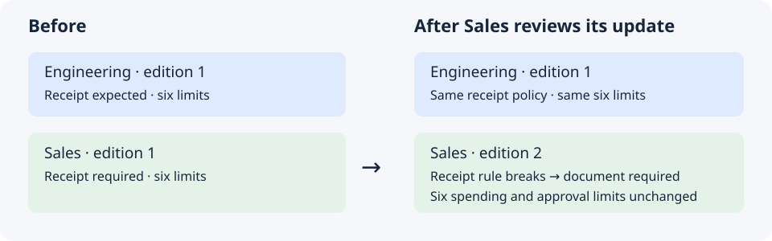

# Two teams, one expense form

Engineering and Sales file expenses on the same form. An expense has a
submitter, an amount, a category and an approval, whichever team it comes from.
Their policies differ: Sales takes clients to dinner, so its meal cap is higher
and its team leads may approve more.

The usual fix is to copy the expense model and change the numbers. That works
until Finance changes what the form means. One copy gets the change, the other
does not, and two reports that both say "approved" stop meaning the same thing.

On this page you keep **one shared model** of what an expense is, and give each
team a **small policy of its own** on top of it. Each team checks its expenses
against the whole thing: the shared definitions plus its own rules. You type
requests; GND does the checking. All the data is synthetic.

<div class="app-figure" markdown="1" role="region" tabindex="0" aria-label="One shared expense model, two team policies">


</div>

*Source: the shipped expense example, extended with a shared expense model,
two team policies and receipt facts. Every result below comes from a
real run of the [commands behind it](../how-to/shared-expense-policies-commands.md).
The requests are suggestions, not recordings of an agent conversation.*

!!! info "Files on GitHub"

    - [The shared expense model](https://github.com/vasiloglou/gnd-public/blob/main/src/gnd/examples/expense/teams/shared/expense-v1.orm.json)
    - [Engineering's policy](https://github.com/vasiloglou/gnd-public/blob/main/src/gnd/examples/expense/teams/engineering.orm.json)
    - [Sales's policy](https://github.com/vasiloglou/gnd-public/blob/main/src/gnd/examples/expense/teams/sales.orm.json)
    - [The facts and all example files](https://github.com/vasiloglou/gnd-public/tree/main/src/gnd/examples/expense/teams)

## The result in one table

| | Two copies of the model | One shared model, two policies |
|---|---|---|
| What an expense is | written separately in each copy | written once |
| A team's own rules | mixed in with the definitions | a short file of its own: 6 limits and a receipt rule |
| The same 90 EUR dinner | whatever each copy happens to say | blocked for Engineering, accepted for Sales, on purpose |
| Finance changes a definition | edit every copy by hand | each team sees which of its rules break before anything changes |

## Who does what

| Who | Does what |
|---|---|
| Finance | owns the shared model: what an expense is |
| Each team | owns its policy: its limits and its receipt rule |
| You | ask Claude Code, read the answers, decide |
| GND | reads the shared model and a team's policy as one model, and checks expenses against all of it |

A team's policy never copies a shared definition and cannot change one. It says
which edition of the shared model it builds on, the way a contract cites the
2026 edition of a handbook and not just "the handbook".

**Before you start.** Install GND 0.3.0 or later with pip in an activated virtual environment, as the
[installation page](../installation.md) shows, and add the Claude Code plugin as the [plugin page](../marketplace-plugins.md)
shows. The [commands page](../how-to/shared-expense-policies-commands.md) has
the copy step and every command behind the requests below.

## The expenses

These are the three expenses from the [expense tutorial](../expense/01-model.md),
each now with a receipt number.

| Expense | Employee | Category | Amount | Approval | Receipt |
|---|---|---|---:|---|---|
| 101 | Ari | Meals | 60 EUR | pending | R-101 |
| 102 | Bea | Travel | 800 EUR | pending | R-102 |
| 103 | Ari | Equipment | 1,400 EUR | finance | R-103 |

## The two policies

| | Engineering | Sales |
|---|---:|---:|
| Meals, at most | 75 EUR | **120 EUR** |
| Training, at most | 1,500 EUR | 1,500 EUR |
| Travel, at most | 2,000 EUR | 2,000 EUR |
| Equipment, at most | 3,000 EUR | 3,000 EUR |
| A team lead approves up to | 100 EUR | **1,000 EUR** |
| Finance approves up to | 3,000 EUR | 3,000 EUR |
| Receipts | an expense **should** have one | an expense **must** have one |

Engineering's numbers are the expense tutorial's, unchanged. Sales's are new.

## Part 1: share the definitions, keep your own rules

### 1. See what is shared and what is yours

**You type**

```text
Read me Engineering's expense policy in plain English. Read the shared definitions and Engineering's own policy file too, and explain
which rules each file contributes.
```

**Claude Code does** ask GND to read the whole model back, then compares it
with the two source files. GND reads both as one model; the grouping below
comes from those source files.

**GND says**

| Comes from | What it says |
|---|---|
| The shared model | An expense is submitted by one employee, has one amount and is in one category. Categories are meals, training, travel and equipment. An approval names a submitted expense and one chain, team-lead or finance. An expense has at most one receipt. |
| Engineering's policy | The four category caps and the two approval limits above. An expense should have a receipt. |

Engineering's file holds seven rules. The model GND checks holds all of them
plus everything shared.

### 2. Give Sales its own policy

**You type**

```text
Create a Sales expense policy that builds on the same shared expense model.
Meals up to 120 EUR. A team lead approves up to 1000 EUR. Everything else as
in Engineering. Every Sales expense must have a receipt. Do not copy or change
any shared definition. Validate it and read it back to me.
```

**Claude Code does** write a short policy file for Sales and ask GND to
validate it. The example ships the result, so you can skip the writing.

**GND says** the Sales policy is valid. Read back, its team-lead
rule is the sentence from the expense tutorial with one number changed: *if an
expense is approved by team-lead and has an amount, that amount is at most
1000*. The shared sentences are the same ones Engineering sees.

### 3. Same expenses, two verdicts

Two mistakes from the expense tutorial come back here: Ari's dinner claimed at
90 EUR, and Bea's 800 EUR trip approved by a team lead.

**You type**

```text
Check the 90 EUR dinner against Engineering's policy and against Sales's.
Then do the same for the trip approved by a team lead.
```

**GND says**

| The expense | Under Engineering's policy | Under Sales's policy |
|---|---|---|
| 101: a 90 EUR meal | **blocked**: meals are at most 75 EUR | accepted: meals are at most 120 EUR |
| 102: 800 EUR, approved by a team lead | **blocked**: a team lead approves at most 100 EUR | accepted: a team lead approves at most 1,000 EUR |

The Engineering column is what the expense tutorial reports today for the same
facts. Neither verdict is a mistake: each team gets the answer its own policy
gives, and both agree on what an expense, a meal and a team lead are.

### 4. One relationship, two rules about it

The shared model says an expense *may* have a receipt. It does not say whether
one is required. That is each team's call, and each team hangs its own rule on
the same shared relationship.

Bea loses the receipt for the trip.

**You type**

```text
Expense 102 has no receipt. Check it against both policies and tell me what
each team is asking for.
```

**GND says**

| | Engineering | Sales |
|---|---|---|
| The team's words | "An expense should have a receipt." | "No receipt, no reimbursement." |
| Kind of rule | **advisory** | **must** |
| What GND reports for expense 102 | a **warning**; the check still passes | a **violation**; the check fails |
| What the team wants done | attach the receipt if it turns up | add the receipt, then check again |

A warning tells you something is off and lets the work continue. A violation
stops it. The same missing receipt is one or the other because each team said
so in its own policy, not because the checker guessed.

### 5. The shared model cannot change under you

Each policy records the exact edition of the shared model it was written
against. Suppose someone edits the shared file in place, say to add a fifth
category, without publishing a new edition.

**You type**

```text
Someone edited the shared expense model directly. Check the seed expenses
against Sales's policy again.
```

**GND says** no. The shared file no longer matches the edition
Sales's policy names, so GND refuses to load the model and checks nothing. A
definition both teams rely on can only change as a new edition, in the open.

## Part 2: Finance changes a shared definition

Finance starts accepting e-invoices as well as paper receipts. It publishes a
second edition of the shared model: "Expense has Receipt" is replaced by
"Expense is supported by Document". The first edition stays where it is.



*Source: the shipped [expense team models and proposals](https://github.com/vasiloglou/gnd-public/tree/main/src/gnd/examples/expense/teams), exercised by the [command walkthrough](../how-to/shared-expense-policies-commands.md#review-edition-2).*

### 6. Ask what the update would break

**You type**

```text
Finance published edition 2 of the shared expense model. Preview moving
Sales's policy to it. Do not change anything yet.
```

**GND says** the move, on its own, does not work, and name why: Sales's
rule *every expense must have a receipt* hangs on a relationship edition 2 no
longer has. The six limits are not named, because nothing they use changed.
Nothing is published; Sales's policy is exactly as it was.

| Sales's rule | In edition 2 |
|---|---|
| The four category caps | unaffected |
| The two approval limits | unaffected |
| Every expense must have a receipt | **broken**: "Expense has Receipt" is gone |

### 7. Repair it in one reviewed change

**You type**

```text
Move Sales's policy to edition 2 and, in the same change, restate the receipt
rule as: every expense must be supported by a document. Preview it, show me
what it affects, and wait for my go-ahead.
```

**GND says** the combined change is valid, and will mark it as one that
needs your explicit acceptance. After you accept, only Sales's policy file
changes. The shared model is never written by a team's change.

**You get** a Sales policy on edition 2. An expense with a document passes;
an expense without one is blocked, as the missing receipt was in step 4.

### 8. What stays put

- **Engineering has not moved.** Its policy still names edition 1 and checks
  as before. It makes the same move when it is ready, with its own preview.
- **A team cannot edit a shared definition.** If Sales asks to add a category
  to the shared list from inside its own policy, GND refuses and says the
  definition belongs to the shared model. That request goes to Finance.

## What you did

| Step | What happened | Who checked it |
|---|---|---|
| 1 | read one policy back, shared and own sentences together | GND |
| 2 | Sales got a policy without copying a definition | GND validated it |
| 3 | one dinner and one trip, two correct verdicts | GND, once per policy |
| 4 | one missing receipt: a warning for one team, a violation for the other | GND |
| 5 | an in-place edit to the shared model was refused | GND |
| 6–8 | a new edition named the one rule it breaks; one change repaired it | GND, before anything was published |

## What this does not establish

- **That either policy is wise.** GND checks expenses against the rules each
  team wrote. It does not judge the rules.
- **That the shared model is right.** Naming an edition proves which
  definitions you built on, not that Finance got them right.
- **Anything about a generated application.** The expense tutorial's generated
  project does not yet accept a policy built on a shared model. This page
  checks facts directly.

The exact rules for building one model on another are in the
[model includes reference](https://github.com/vasiloglou/gnd-public/blob/main/src/gnd/skills/gnd-orm-core/references/representation-format.md#model-includes-version-5).
